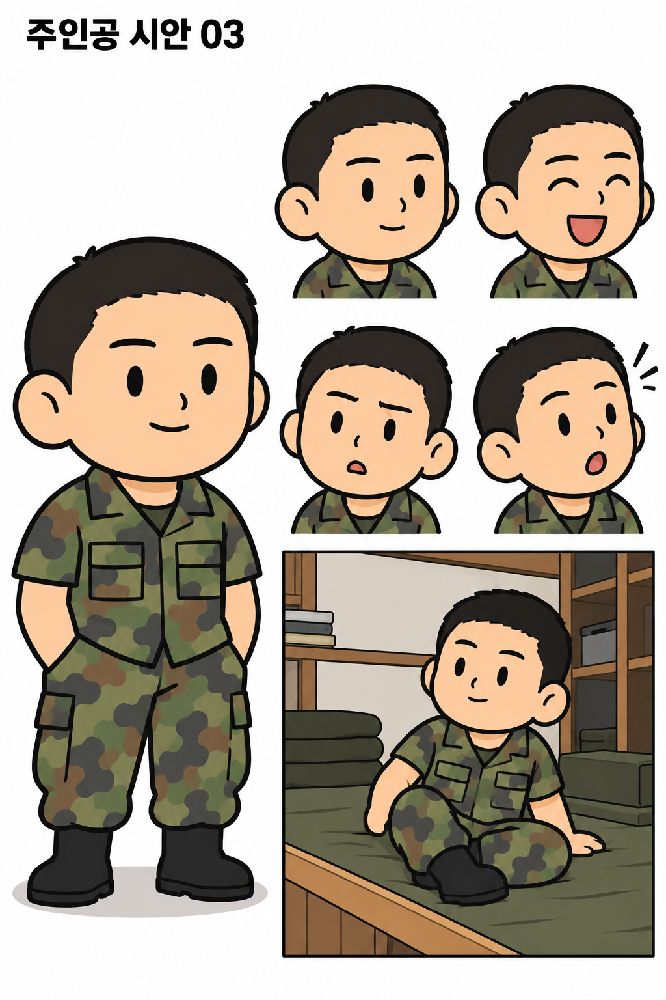
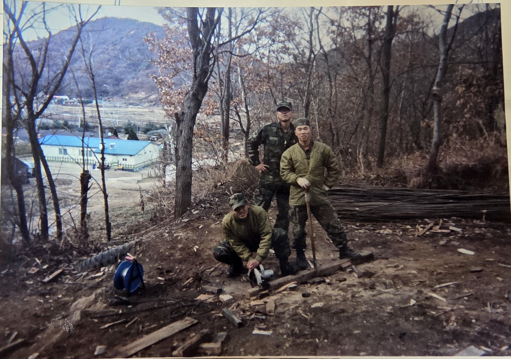
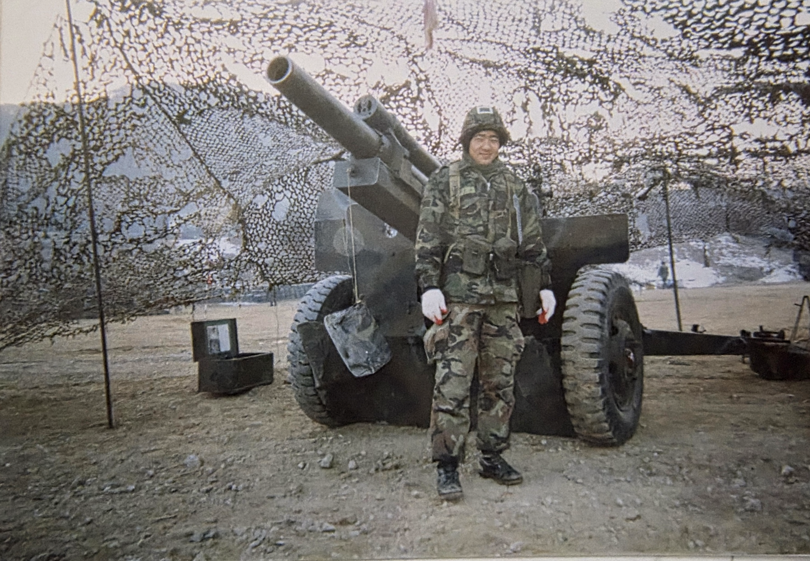
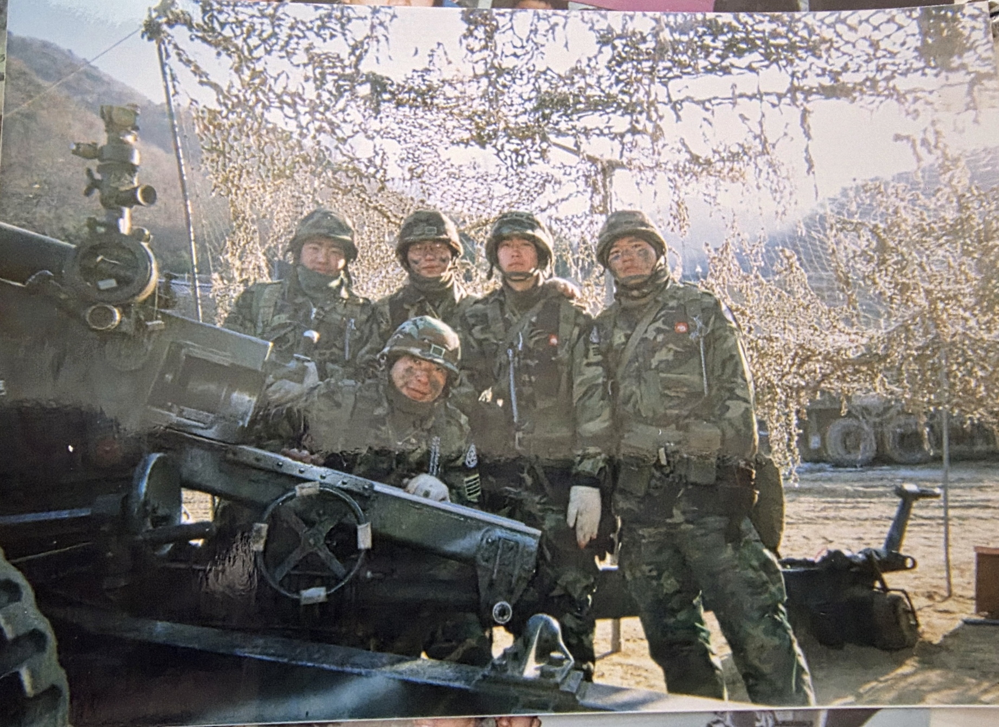
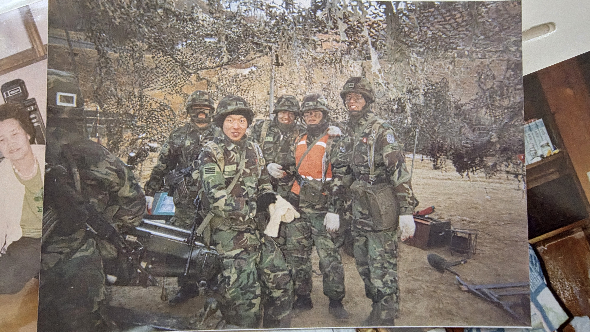
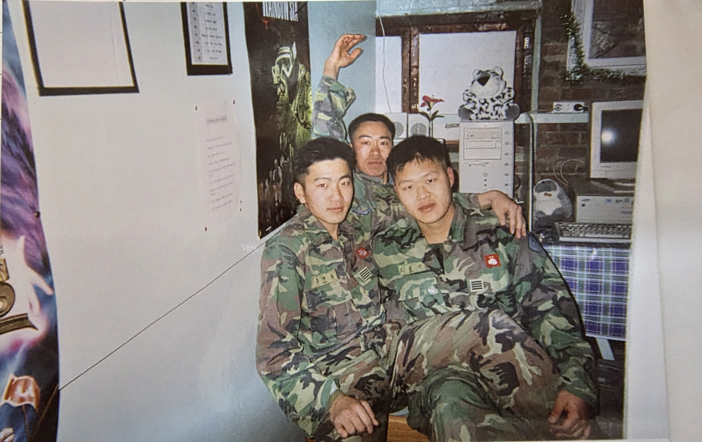
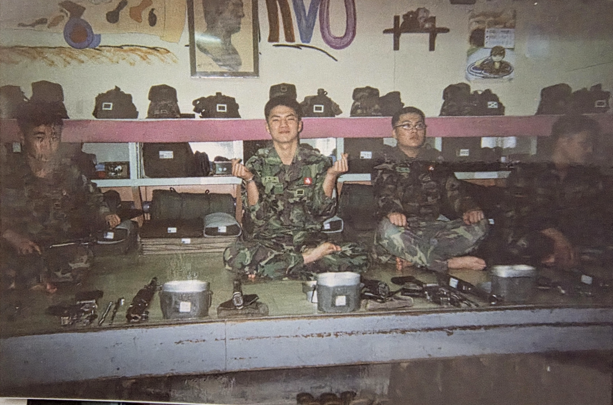
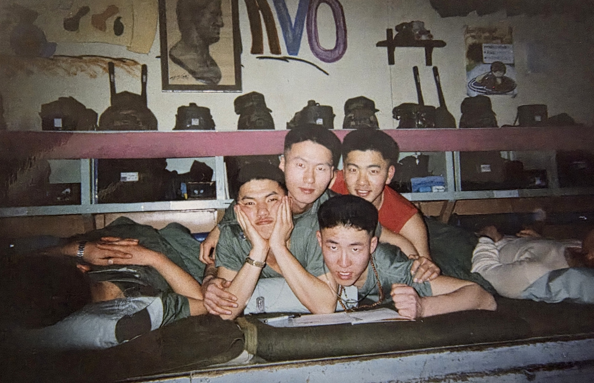
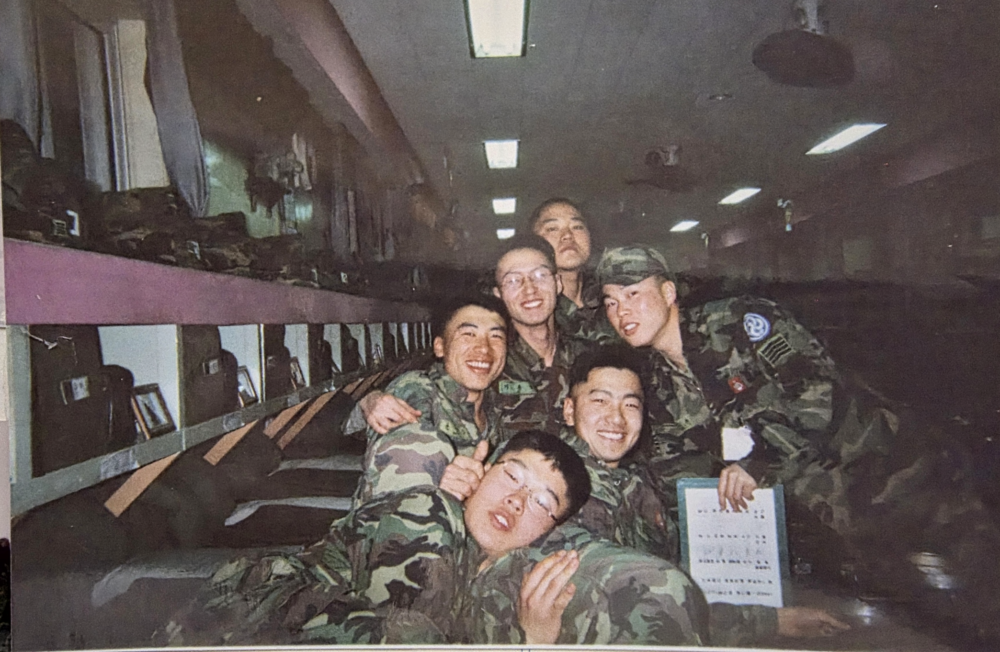

# 군대 썰만화 제작 기준 v1

기준 작성일: 2026-11-02. 실제 복무 사진 8장과 사용자 설명을 우선한다. 이후 기억 확인과 자료 검증에 따라 갱신한다.

## 1. 이야기와 주인공

- 본인이 겪은 군 생활의 여러 상황을 연재한다. 주인공을 특이한 인물로 과장하지 않고, 사건과 인물들의 반응에서 재미를 만든다.
- 사용자 설명: 1998년 1월 입대, 6주 훈련 후 자대 배치. 28사단 포병 알파포대.
- 추가 기억: 전곡에 있던 2728부대에서 복무했다. 사용자 기억으로 기록하며, 공개 자료로 확인된 사실과 구분한다.
- 앞서 기억한 268이라는 대대 번호는 아직 추정이다. 2728부대와 268대대의 관계, 당시 정확한 편제와 부대 호칭은 미확인이다. 둘을 같은 번호 체계로 보거나 어느 한쪽을 오기로 단정하지 않는다.
- 사용자 설명: 당시 65kg, 평범한 얼굴과 체격. 밖에서는 밝았고 군대에서는 평범하게 생활했다. 키는 미확인이다.
- 최초 단체 사진을 바로 세웠을 때 맨 왼쪽 군복 착용자가 본인이다. 다른 사진 속 본인의 위치와 다른 인물의 신원은 임의로 지정하지 않는다.
- 그림체: 마지막 시안의 큰 머리·짧은 몸, 약 3등신. 단순한 눈·코·입, 굵은 선, 적은 명암. 성인 군인으로 읽히게 한다.
- 주인공의 짧은 머리와 얼굴 실루엣을 유지하며, 표정은 장면에 따라 바꾼다. 과도한 미남화·근육질화·유아화는 피한다.

이 이미지는 그림체 참고다. 반소매 전투복, 군화를 신은 침상 장면 등 생성 과정에서 들어간 요소는 당시 생활의 근거로 사용하지 않는다.

## 2. 근거의 우선순위

1. 사용자가 구체적으로 기억하고 정정한 내용.
2. 제공 사진에서 실제로 식별되는 외형과 배치.
3. 연도·부대·장면에 맞는 외부 자료로 확인한 내용.
4. 화면 구성을 위한 단순화와 연출. 사실로 취급하지 않는다.

자료가 충돌하면 확정하지 않고 확인 항목으로 남긴다. 한 장의 사진에서 보이지 않는 공간을 다른 사진의 구조로 자동 완성하지 않는다. 보정본은 밝기·색감·대비가 조정되었으므로 정확한 원색의 근거는 원본과 함께 판단한다. 앞서 생성한 캐릭터 그림은 고증 자료가 아니다.

## 3. 전투복·모자·장구류

사진 근거:

- 녹색·갈색·짙은 색이 섞인 비디지털 얼룩무늬 전투복. 사진 속 무늬와 색 배치를 참고한다.
- 여유 있는 긴소매 상의와 긴바지, 상의의 가슴 주머니, 명찰·계급장·부대표지, 어두운 군화가 보인다.
- 실내 사진의 전투모와 야외 사진의 위장무늬 철모를 장면에 맞게 구분한다. 철모 턱끈이 보이는 장면은 그 착용 상태를 참고한다.
- 야외 사진에는 허리띠와 멜빵 형태의 장구류, 장갑 등이 보인다. 장구류의 정확한 명칭과 세부 형식은 확대 확인 전에는 확정하지 않는다.

작화 기준:

- 얼룩무늬를 큰 색 덩어리로 줄이되, 군복이 단색 작업복이나 현대 디지털 군복으로 바뀌지 않게 한다.
- 긴소매 전투복을 기본 참고로 삼고, 소매를 걷었는지·상의가 무엇인지는 실제 에피소드에 맞춘다. 반소매 전투복을 기본형으로 고정하지 않는다.
- 명찰·표지를 작은 도형으로 단순화할 수 있다. 읽히지 않는 이름·계급·부대번호는 만들어 쓰지 않는다.
- 현대 방탄조끼·헬멧 액세서리·장비는 근거 없이 추가하지 않는다.

## 4. 평상복·내무반 생활 복장

사진 근거:

- 실내 단체 사진에는 회녹색·올리브색 계열의 둥근 목 티셔츠와 편한 바지가 보인다.
- 사진에 따라 다른 색의 상의도 보인다. 특정 한 벌을 전원의 통일된 보급 복장으로 단정하지 않는다.
- 전투복 차림으로 함께 앉아 있는 장면도 있다. 맨발·양말 등은 사진과 이야기의 상황을 따른다.

작화 기준:

- 쉬는 장면은 편한 옷, 가까운 거리에서 기대거나 장난치는 자세를 참고한다.
- 당시 보급품의 정식 명칭이나 계절별 복장 규정은 필요할 때 별도 확인한다.
- 군화를 신고 침상 위에 올라가는 모습을 일반적인 생활 모습으로 반복하지 않는다.

## 5. 내무반의 모양과 분위기

사진 근거:

- 사용자 표현: ‘완전 옛날 구식’ 내무반.
- 개인 침대 대신 여러 명이 함께 사용하는 길고 높은 공동 침상이 보인다. 올리브색 계열의 깔개·담요가 놓여 있다.
- 침상 쪽으로 개인 물품을 나누어 놓는 칸형 수납 선반이 이어진다. 분홍색 계열의 긴 가로판과 옅은 청록색 계열의 칸막이·가로대가 눈에 띈다. 촬영·변색 영향을 고려해 색은 근사치로 사용한다.
- 칸과 선반 주변에 가방, 모자, 정리한 침구, 책 등이 있다. 일부 사진에는 세면대야·식기처럼 보이는 금속 용기가 침상 가장자리 쪽에 놓여 있다.
- 긴 내무반 사진에는 이어지는 수납 칸, 통로, 높은 쪽의 창, 천장 조명이 보인다.
- 벽의 포스터와 액자, 실내 사진의 구형 모니터·컴퓨터·오디오 기기는 당시 공간의 참고 요소다. 모든 사진이 같은 방이라는 근거는 없다.
- 쉬는 장면은 사람들이 붙어 앉거나 누워 장난치는 자연스러운 분위기다. 이것을 군 생활 전체의 분위기로 일반화하지 않는다.

작화 기준:

- ‘공동 침상 + 길게 이어지는 칸형 선반 + 짐과 침구 + 구식 실내 마감’을 내무반의 핵심 시각 요소로 삼는다.
- 넓은 컷에서는 공간 구조, 인물 중심 컷에서는 침상 가장자리와 선반 일부만 남겨도 같은 장소로 알아보게 한다.
- 철제 이층침대, 현대 개인 침대, 신식 생활관 인테리어로 바꾸지 않는다.
- 정확한 방 크기, 침상 양쪽 배치, 출입문 위치, 난방 방식, 개인별 자리 순서는 미확인이다. 평면도는 아직 확정하지 않는다.

## 6. 105mm 견인포와 야외 장면

사용자 지정: 포는 105mm 견인포를 기준으로 한다. 정확한 모델명은 미확인이다.

사진 근거:

- 큰 바퀴 두 개, 포신, 방패판, 포가와 조작 부품이 보이는 견인포가 있다.
- 포 주변에 위장망을 친 장면이 있다. 바퀴·방패판·포신의 비례와 병사가 옆에 섰을 때의 크기는 사진을 따라간다.
- 야외 복장은 철모·장구류·장갑 등의 착용 예를 참고할 수 있다.
- 사진에 나무가 잎을 떨군 야외, 흙바닥, 주변 산과 건물 등이 보인다. 날짜와 지명은 사진만으로 단정하지 않는다.

작화 기준:

- 견인포를 자주포나 대형 현대 포로 바꾸지 않는다. 단순화해도 바퀴 두 개·방패판·포신의 실루엣을 유지한다.
- 포를 앞에서 보는 컷과 조작부 쪽에서 보는 컷은 서로 다른 사진을 참고한다. 보이지 않는 기구를 임의로 상세하게 그리지 않는다.
- 위장망은 불규칙한 망의 형태로 줄여 그린다. 인물과 포를 가리는 정도는 장면 가독성에 맞춰 조절한다.
- 제공 사진은 주로 포 옆에서 찍은 기념사진이다. 장전·사격·방열·견인·포반별 동작을 입증하는 사진으로 취급하지 않는다.
- 실제 훈련 장면은 사용자의 경험 설명을 받은 후 당시 동작·호칭·장비를 확인해 구성한다. 포 모델명을 M101 등으로 미리 확정하지 않는다.

## 7. 사진별 참조표

| 파일 | 주된 참고 내용 | 주의점 |
|---|---|---|
| 군대 | 야외 지형, 작업 자세, 복장, 주변 건물 | 구체적인 작업 내용과 장소는 미확인 |
| 군대1 | 전투복, 전투모, 표지 위치, 구형 실내 기기 | 방의 용도는 미확인 |
| 군대2 | 견인포 정면에 가까운 모습, 바퀴·방패판·포신, 위장망, 장구류 | 포 모델 미확인 |
| 군대3 | 견인포 조작부 쪽 모습, 포 주변 인물의 크기, 철모와 장갑 | 실제 훈련 동작을 보여주는 장면으로 단정하지 않음 |
| 군대4 | 공동 침상, 칸형 선반, 가방·모자·침구·금속 용기 | 어두운 인물의 얼굴과 물건을 상상으로 복원하지 않음 |
| 군대5 | 실내 평상복, 휴식 자세, 침상과 선반 | 여러 색의 옷을 모두 보급품으로 단정하지 않음 |
| 군대6 | 내무반의 길이감, 수납 칸의 반복, 창과 조명, 단체 분위기 | 출입문·반대편 구조는 미확인 |
| 군대7 | 견인포 주변 장구류, 위장망, 여러 인물의 복장 | 사진 가장자리에 다른 사진이 함께 찍혀 있음 |

### 야외와 포

### 실내와 생활

## 8. 에피소드를 만들 때

1. 기억나는 사건을 먼저 듣고, 누가·언제·어디서·무슨 일이 있었는지 정리한다.
2. 사용자의 기억, 사진 근거, 확인이 필요한 부분을 나눈다.
3. 해당 장면에 필요한 고증만 확인한다. 확인되지 않은 내용을 사실처럼 채우지 않는다.
4. 실제 대사가 기억나지 않으면 의미를 살린 재구성 대사라는 점을 제작 메모에 남긴다. 새 사건을 실화에 섞지 않는다.
5. 컷 구성 후 이 문서의 복장·배경·인물 비례와 대조한다.

다음 제작에서도 이 문서와 연결된 사진을 함께 제공하면 동일한 기준을 이어갈 수 있다.

